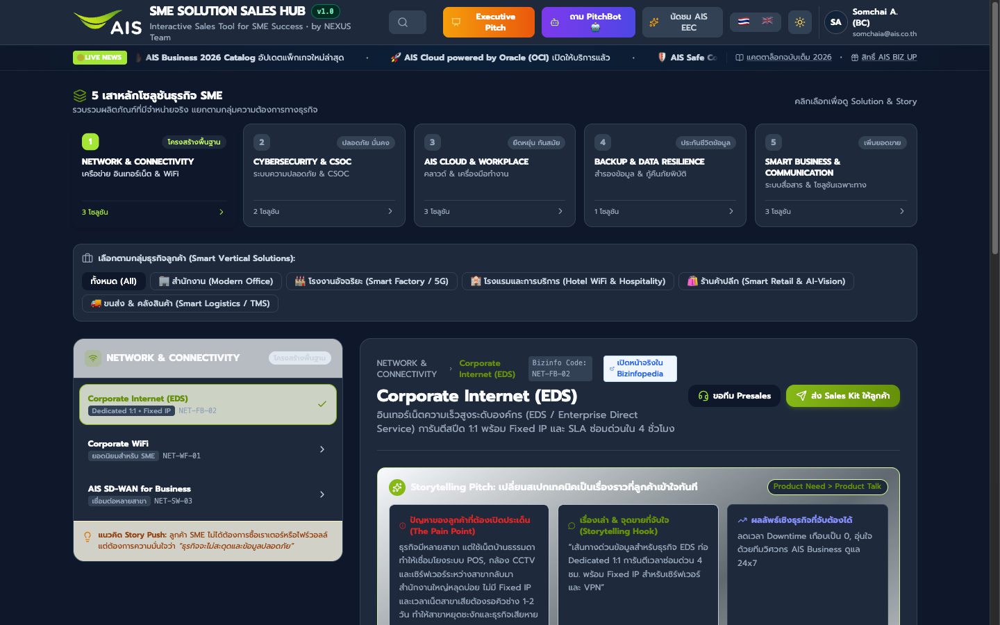
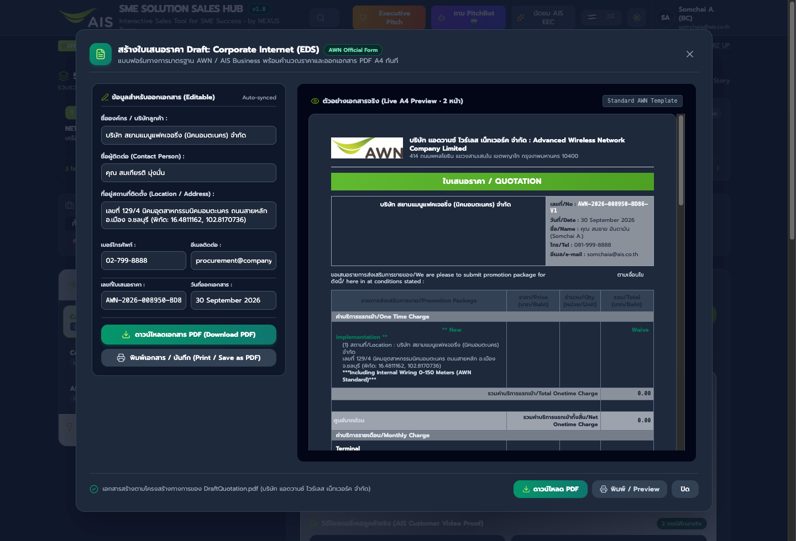
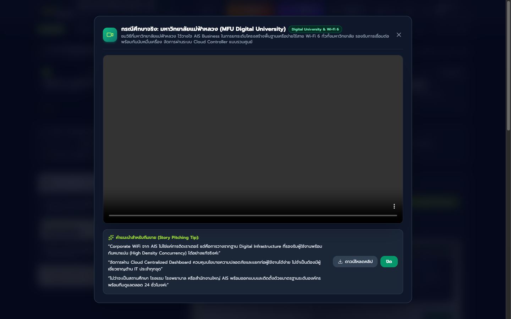
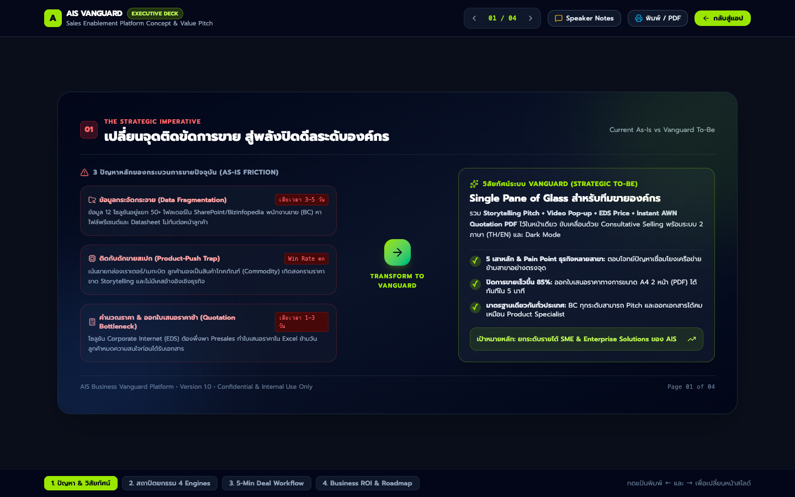

# 🚀 AIS Vanguard Sales Hub (Version 1.0)

> **Next-Generation Sales Enablement Platform for AIS Business & Enterprise Clients**  
> *Transforming telecommunications & digital solution sales cycles from days to minutes.*

[](VERSION_1.0_RELEASE_NOTES.md)
[](index.html)
[](index.html)
[](i18n.js)
[](#-architecture--design-principles)

---

## 📌 Executive Summary

**AIS Vanguard Sales Hub** is an all-in-one, enterprise-grade Sales Enablement Platform developed for **AIS Business / Advanced Wireless Network Co., Ltd. (AWN)**. Designed for Business Consultants (BC), Account Executives (AE), Presales Engineers, and Enterprise Sales Directors (300+ personnel nationwide).

Historically, enterprise sales teams faced scattered product documentation, complex price calculation rules, and turnaround times of 1–3 days just to provide customers with an initial quotation. Vanguard Sales Hub consolidates everything into a **Single Pane of Glass**, empowering sales representatives to discover solutions, address objections with real customer video proofs, calculate pricing, and **generate an official AWN 2-page A4 Draft Quotation PDF in under 5 minutes directly in front of the client**—slashing the sales cycle by over **85%**.

---

## 📸 Platform Previews

| Executive Sales Hub Dashboard | Official AWN Draft Quotation (2-Page A4) |
| :---: | :---: |
|  |  |

| Video Proof Suite & Pitch Tips | 4-Slide Executive Presentation Deck |
| :---: | :---: |
|  |  |

---

## 🌟 Key Features & Capabilities

### 1. 🏛️ 5 Strategic SME Pillars & 12 Core Solutions Catalog
Solutions are structured by genuine customer business needs (*Business Needs > Product Talk*):
1. **Network & Connectivity:** Corporate Internet (EDS), Corporate WiFi, AIS SD-WAN for Business
2. **Cybersecurity & CSOC:** AIS CSOC Managed Security, AIS Safe Connect, Cloud Firewall
3. **AIS Cloud & Workplace:** Microsoft 365 for Business, Google Workspace, AIS Cloud powered by Oracle (OCI)
4. **Backup & Data Resilience:** Cloud Backup & Disaster Recovery (DR)
5. **Smart Business & Communication:** AIS Cloud PBX / MPBX, Smart Retail IoT & AI-Vision, Smart CCTV
* Includes **Smart Vertical Solutions Selector** with deep-linking across 5 key industries (Offices, Factories, Hospitality, Retail, Logistics).

### 2. 📑 Official AWN Draft Quotation PDF Generator (2-Page A4)
* Generates an official, print-ready 2-page A4 quotation for **Advanced Wireless Network Co., Ltd. (AWN)** in under 30 seconds.
* **Page 1:** Customer billing profile, EDS bandwidth package summary, IP address allocation, one-time installation waiver (100% discount), monthly recurring charge (MRC), contract discount, and subtotal + 7% VAT.
* **Thai BahtText Algorithm:** Client-side conversion of numeric totals into official Thai accounting text format (e.g. *“หนึ่งพันเจ็ดร้อยหนึ่งบาทเจ็ดสิบสตางค์”*).
* **Page 2:** Complete 9 commercial terms & conditions (SLA 99.9%, MTTR 4-hour repair guarantee, concession contract terms) with official dual-signature execution block.
* Fully editable on the fly via the modal with instant download and printing.

### 3. 🎬 Customer Video Proof Suite & Consultative Pitch Tips
* Dedicated pop-up theater modal (16:9 HD) with consultative selling wording and offline download capability:
  * **Srisawad Power 1979 PCL** (`BusinessSrisawad-Power-1979.mp4`, 1:50 min) — *Corporate Internet (EDS)*: Addressing nation-wide branch stability, multi-branch POS/VPN reliability, and 99.9% SLA.
  * **KTIS Group** (`Business-KTIS_001_720p.mp4`, 2:01 min) — *Corporate Internet (EDS)*: Large-scale agricultural manufacturing, heavy industrial plants, and remote site connectivity.
  * **Mae Fah Luang University / MFU Digital University** (`WIFIDigitalUniversity.mp4`, 3:25 min) — *Corporate WiFi*: High-density concurrency Wi-Fi 6 infrastructure for higher education, campus, hospitals, and hospitality managed via Centralized Cloud Controller.
* **Story Pitching Tips:** Wording formulated to elevate conversations from commodity bandwidth pricing to business resilience and 24/7 mission-critical operations.

### 4. 🎯 Multi-Branch Pain Point Transformation ("มีหลายสาขา")
* Re-aligns the Corporate Internet (EDS) pitch around multi-branch operational bottlenecks:
  * Preventing POS checkout counters and security CCTV from dropping offline.
  * Eliminating unstable VPN tunnels to HQ ERP/SAP/Express accounting servers.
  * Ending 1–2 day residential technician wait times with guaranteed **MTTR 4-hour emergency dispatch** and permanent Static Public IPs.

### 5. 🌍 Modern Experience Suite (Bilingual i18n & Executive Dark Mode)
* **Bilingual Engine (🇹🇭 Thai / 🇬🇧 English):** Instant one-click toggle across dashboard controls, solution cards, modals, video proof stories, and sales kits.
* **Executive Dark Mode:** High-contrast, eye-friendly dark palette tailored for boardroom projectors and field tablets (iPad/Surface), while keeping the quotation paper white for print compliance.
* **Continuous Looping Marquee Ticker:** Seamlessly rotating business bulletin announcing 2026 packages, Oracle Cloud Infrastructure (OCI), and AIS Safe Connect updates.

### 6. 📊 4-Slide Executive Presentation Deck (`executive_deck.html`)
* Boardroom-ready web-based presentation deck:
  * **Slide 1:** The Strategic Imperative (As-Is Friction vs To-Be Single Pane of Glass)
  * **Slide 2:** Product Architecture (The 4 Core Platform Engines)
  * **Slide 3:** Field-Tested User Journey (5 Minutes to Close the Deal)
  * **Slide 4:** Business Impact & Strategic Rollout Roadmap
* Features speaker notes drawer, keyboard navigation (`←` / `→`), fullscreen mode, and print-to-PDF support.

### 7. 🤖 AI PitchBot Assistant & Presales Fast-Track Workflow
* **AI PitchBot:** Objection handling practice bot addressing EDS vs Home Broadband, Fixed IP necessity, SLA response guarantees, and 5G Wireless Backup.
* **Presales Fast-Track:** One-click ticket handoff form generating automated ticket references for complex customer architectural requirements.

### 8. 🔄 Interactive Sales Lifecycle Workflow
* Collapsible step-by-step guidance cards for each phase of the consultative sales cycle:
  1. Discovery & Needs Assessment
  2. Storytelling & Video Proof
  3. Tailored Solution Configuration
  4. Instant Quotation & Closing
* Includes quick "Read More" expansions and an "Expand All" master toggle.

---

## 🏆 Business Impact & KPIs

| Metric | Baseline (Before) | Vanguard Hub (v1.0) | Business Impact |
| :--- | :---: | :---: | :---: |
| **Sales Turnaround Velocity** | 1–3 Days | **< 5 Minutes** | **85% Faster** cycle to quotation |
| **Win Rate Uplift** | Baseline | **+35%** | Boosted by video social proof & consultative tips |
| **Presales Workload Reduction** | Heavy manual quoting | **-50% repetitive load** | Presales engineers focus on complex enterprise designs |
| **Field Availability** | VPN / Intranet bound | **100% Offline Capable** | Operates on client laptops without external dependencies |

---

## 🛠️ Architecture & Tech Stack

Vanguard Sales Hub is architected for zero-latency, high reliability, and zero build-step overhead:

```
vanguard_project/
├── index.html                 # Main Single Page Application (SPA)
├── executive_deck.html        # 4-Slide Boardroom Deck with Speaker Notes
├── release_notes_v1.html      # Printable HTML Version 1.0 Release Notes
├── draft_quotation.js         # AWN Quotation Generator Engine & Thai BahtText
├── solution_kits.js           # 12 Solutions Catalog, Datasheets, Site References
├── i18n.js                    # Bilingual Dictionary & Runtime Switcher (TH/EN)
├── html2pdf.bundle.min.js     # Client-Side PDF Generation Engine
└── assets/                    # Case study videos (720p HD), official logos & icons
```

- **Frontend Core:** Pure HTML5, Modern ECMAScript (Vanilla JS), CSS Grid & Flexbox.
- **Styling:** [Tailwind CSS](https://tailwindcss.com/) with custom AIS enterprise design tokens.
- **Iconography:** [Lucide Icons](https://lucide.dev/).
- **Document Engine:** [html2pdf.js](https://ekoopmans.github.io/html2pdf.js/) for in-browser canvas-to-PDF rendering with zero backend server dependencies.
- **Zero Build Step:** Runs directly in any modern browser without needing `npm install`, Node.js, or compilation steps.

---

## 🚀 Quick Start Guide

### Option 1: Open Directly in Browser
Double-click `index.html` or open it with any modern web browser (Google Chrome, Microsoft Edge, Safari, Mozilla Firefox):
```bash
open index.html
```

### Option 2: Local HTTP Server (Recommended)
Running via a local HTTP server ensures smooth video streaming and prevents CORS restrictions on local asset loading:

Using Python 3:
```bash
python3 -m http.server 8080
```
Then navigate to: `http://localhost:8080` in your web browser.

To view the Executive Presentation Deck:
```
http://localhost:8080/executive_deck.html
```

---

## 📱 Supported Devices & Browsers

- **Desktops & Laptops:** macOS, Windows, ChromeOS, Linux (Chrome, Safari, Edge, Firefox)
- **Tablets:** Apple iPad (Safari / Chrome), Microsoft Surface (Edge)
- **Responsive Layout:** Optimized for 1080p, 2K/4K displays, and mobile tablet viewports.

---

## 📄 Key Documents & Release Notes

- [VERSION_1.0_RELEASE_NOTES.md](VERSION_1.0_RELEASE_NOTES.md) — Official full-length release documentation.
- [AIS_Vanguard_Sales_Hub_v1.0_Release_Notes.pdf](AIS_Vanguard_Sales_Hub_v1.0_Release_Notes.pdf) — Printable executive release notes PDF.
- [AIS Corporate Internet For Customer.pdf](AIS%20Corporate%20Internet%20For%20Customer.pdf) — Comprehensive 28-page enterprise presentation collateral.

---

## 👥 Authors & Acknowledgments

- **AIS Business Vanguard Engineering Team**
- **Advanced Wireless Network Co., Ltd. (AWN) / Advanced Info Service PCL (AIS)**
- **Enterprise Product & Presales Division**

*© 2026 Advanced Wireless Network Co., Ltd. All rights reserved.*
